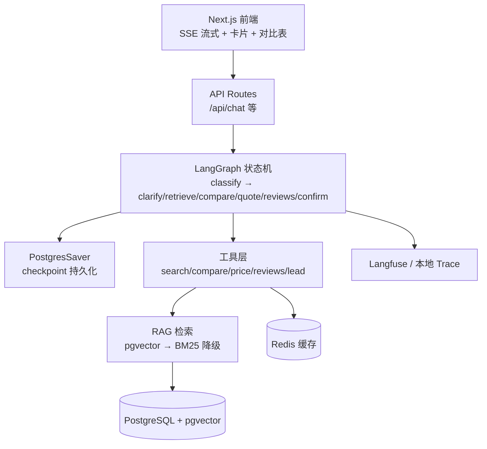

# 懂车顾问 · 选车决策 Agent

> 一个面向汽车垂类的 **Agent 全链路作品集项目**：需求澄清 → 候选筛选 → 可解释推荐 → 多车对比 → 落地价估算 → 试驾预约（人工确认）。
>
> 核心设计原则：**LLM 不做事实来源，只做理解与表达；事实交给结构化数据，决策交给规则与评测。**

---

## 1. 技术栈

| 层 | 技术 | 说明 |
| --- | --- | --- |
| 前端 | Next.js 16 + React 19 | SSE 流式渲染、车型卡片、对比表 |
| 后端 | Node + TypeScript | 与前端同语言，API Routes |
| Agent 编排 | **LangGraph 1.x** | 状态机、条件边、Checkpointer、`interrupt` |
| 数据 | PostgreSQL + **pgvector** | 结构化车型库 + 向量检索 |
| 缓存 | Redis | 工具结果缓存、可降级为内存 |
| 可观测 | **Langfuse** | trace/span，可降级为本地 trace |
| LLM | LangChain `ChatOpenAI` | 有 Key 走真实模型，无 Key 走 mock |

> **可降级设计**：没有 `DATABASE_URL` / `REDIS_URL` / `LANGFUSE_*` / `OPENAI_API_KEY` 时，项目依然可以完整跑通（内存数据 + 本地 trace + 模板回答）。

---

## 2. 快速开始

```bash
# 1. 安装依赖（Node >= 20）
pnpm install

# 2. 直接启动（mock 模式，无需任何 Key）
pnpm dev
# 打开 http://localhost:3000
```

### 接入真实 LLM

```bash
cp .env.example .env
# 填入 OPENAI_API_KEY
pnpm dev
```

### 接入 PostgreSQL + pgvector / Redis

```bash
docker compose up -d          # 启动 pgvector + redis
cp .env.example .env          # 确认 DATABASE_URL / REDIS_URL
pnpm db:seed                  # 写入车型与评测数据（有 Key 时同时生成 embedding）
pnpm dev
```

### 接入 Langfuse

在 `.env` 填 `LANGFUSE_PUBLIC_KEY` / `LANGFUSE_SECRET_KEY` / `LANGFUSE_BASE_URL`，
所有 Agent 步骤会自动上报 trace；不填则使用本地 trace（可通过 `/api/trace/:id` 查看）。

---

## 3. 运行评测

```bash
pnpm eval
```

当前基线：**20/20 = 100%**，覆盖：

| 类别 | 用例数 | 校验点 |
| --- | --- | --- |
| 推荐 | 6 | 候选非空、预算约束、能源约束、座位约束、引用 |
| 澄清 | 2 | 信息不足时必须追问 |
| 对比 | 2 | 生成结构化对比 |
| 报价 | 2 | 落地价计算 + 免责声明 |
| 口碑 | 2 | RAG 检索到引用 |
| 预约 | 2 | interrupt 暂停 → resume → 提交成功 |
| 安全 | 4 | 注入检测、广告法替换、输入长度限制 |

---

## 4. 架构



### 目录结构

```
app/
  page.tsx                 首页
  api/chat/route.ts        SSE 流式对话主接口
  api/cars/[id]/route.ts   车型详情
  api/compare/route.ts     车型对比
  api/leads/route.ts       试驾线索
  api/trace/[id]/route.ts  本地 trace 查询
components/
  Chat.tsx                 对话 UI（工具时间线、卡片、对比表、人工确认）
src/
  agent/graph.ts           ⭐ LangGraph 状态机（核心）
  agent/runner.ts          回合执行器（interrupt / resume / 护栏 / trace）
  agent/intent.ts          意图与约束解析（规则层）
  agent/llm.ts             LLM 润色 + 流式兜底
  tools/index.ts           ⭐ 工具真实实现（含鉴权与幂等校验）
  rag/retriever.ts         pgvector 检索 + 关键词降级
  db/                      pg 连接、仓储层、schema、种子脚本
  cache/redis.ts           Redis 缓存 + 内存降级
  observability/trace.ts   Langfuse + 本地 trace
  guardrails/guard.ts      ⭐ 广告法 / PII / 注入检测
  eval/eval.ts             ⭐ 20 条评测用例
```

---

## 5. 核心设计（面试重点）

### 5.1 LLM 不做事实来源

- 车型参数、价格、座位数只从结构化数据读取；
- LLM 只负责把「事实底稿」组织成自然语言；
- 因此不会出现"模型编造某车有座椅通风"的问题。

### 5.2 结构化优先，RAG 补充

- 硬约束（预算/能源/座位/车身）用 SQL/内存过滤，**精确且可解释**；
- 评测口碑走 RAG，返回带来源的引用；
- 优先 pgvector 语义检索，失败自动降级 BM25 关键词检索。

### 5.3 人机协同（Human-in-the-loop）

`src/agent/graph.ts` 的 `confirmNode`：

```ts
const confirmReply = interrupt({ type: "confirm", question: "确认预约试驾吗？" });
if (!/确认|是|好/.test(String(confirmReply))) return { answer: "已取消预约。" };

const phoneReply = interrupt({ type: "phone", question: "请提供手机号" });
// 恢复后提交线索
```

- `interrupt()` 暂停图执行，问题返回前端；
- 用户回复后，`new Command({ resume })` 从 **checkpoint** 继续，不重跑已完成步骤；
- 预约提交前**服务端强制校验 `confirmed`**，不信任前端/模型。

### 5.4 护栏在代码层，不只在 prompt

- 注入检测：`detectInjection()`（HTTP 层拦截）
- 广告法：绝对化用语自动替换 + 价格免责声明
- PII：手机号脱敏展示、哈希存储
- 工具鉴权：`create_test_drive_lead` 校验 `confirmed` 与手机号格式

### 5.5 外部依赖全部可降级

| 依赖 | 缺失时 |
| --- | --- |
| OpenAI Key | 模板回答 + 打字机流式 |
| PostgreSQL | 内置样本数据 |
| Redis | 进程内 Map 缓存 |
| Langfuse | 本地 trace（可按 traceId 查询） |

---

## 6. API

| 接口 | 方法 | 说明 |
| --- | --- | --- |
| `/api/chat` | POST (SSE) | 对话主接口，支持 `message` 与 `resume` |
| `/api/cars/:id` | GET | 车型详情 |
| `/api/compare` | POST | `{ modelIds: string[] }` |
| `/api/leads` | POST | `{ sessionId, modelId, city, phone, confirmed }` |
| `/api/trace/:id` | GET | 本地 trace 详情 |
| `/api/health` | GET | LLM/DB/Redis/Langfuse 状态 |

### SSE 事件

| 事件 | 数据 | 前端用途 |
| --- | --- | --- |
| `session` | `{ sessionId }` | 绑定会话 |
| `trace` | `{ traceId }` | 排障入口 |
| `tool` | `{ name, summary, ms, ok }` | "正在筛选车型…" |
| `card` | `Candidate` | 车型卡片 |
| `comparison` | `Comparison` | 对比表 |
| `citation` | `Citation` | 来源引用 |
| `stage` | `{ stage }` | 当前阶段 |
| `delta` | `{ text }` | 流式文本 |
| `interrupt` | `{ type, question }` | 人工确认/输入手机号 |
| `quickReplies` | `{ options }` | 推荐下一步 |
| `done` | `{ mode, stage }` | 结束 |

---

## 7. 项目亮点（简历/面试可直接用）

1. **全链路**：Next.js 前端 → API → LangGraph 编排 → 工具 → RAG → 数据层 → 可观测。
2. **可解释推荐**：每款车给出"为什么推荐 + 短板"，且可追溯到结构化字段。
3. **真实 HITL**：`interrupt()` + Checkpointer 实现"确认 → 手机号 → 提交"的暂停恢复。
4. **工程化**：20 条评测集（100% 通过）、trace、SSE、注入/广告法护栏。
5. **可降级**：无 Key、无数据库都能跑，适合演示与面试现场。

### 面试讲法（60 秒版）

> 我做了一个汽车垂类的选车决策 Agent。核心判断是：**LLM 不能作为事实来源**。所以车型参数和价格全部走结构化数据，LLM 只负责理解需求和表达。
> 编排用 LangGraph，把"澄清→筛选→推荐→对比→报价→预约"做成状态机；预约环节用 `interrupt()` 实现人工确认，`Command(resume)` 从 checkpoint 恢复。
> 工程上配了 20 条评测集做回归，接了 trace 看每一步工具调用，并做了广告法、注入、PII 三层护栏。
> 外部依赖全部可降级：没有 Key 也能完整演示。

---

## 8. 已知限制与下一步

- [x] Checkpointer 已接入 **PostgresSaver**（无 DATABASE_URL 时自动降级 MemorySaver）
- [ ] RAG 目前是"向量 + 关键词"，可加 rerank 提升召回质量
- [ ] 车型数据为虚构演示数据，接入真实数据需做清洗与授权
- [ ] 可扩展为 MCP Server，供多个 Agent/宿主复用工具
- [ ] 可增加多 Agent 编排（选车顾问 + 价格顾问 + 内容顾问）

---

## 8.1 Checkpointer（状态持久化）

| 条件 | 使用的 Checkpointer | 说明 |
| --- | --- | --- |
| 有 `DATABASE_URL` | **PostgresSaver** | 状态写入 `checkpoint_*` 表，跨重启/多实例恢复 |
| 无 `DATABASE_URL` | MemorySaver | 仅内存，适合本地开发/测试 |
| PG 连接失败 | MemorySaver（自动降级） | 不影响主流程 |

PostgresSaver 首次运行会自动建表：

```sql
checkpoint_migrations
checkpoints
checkpoint_blobs
checkpoint_writes
```

清理 30 天未活跃会话的检查点：

```bash
psql "$DATABASE_URL" -f scripts/clear-checkpoints.sql
```

## 9. 数据与合规声明

- 本项目所有车型、参数、价格、评测均为**虚构演示数据**，不代表任何真实在售车型；
- 价格估算仅供参考，实际以经销商报价与官方配置为准；
- 不构成购买建议；不涉及任何公司内部数据。

---

## 10. 本地数据库（macOS 一键脚本）

如果本机已经装好 PostgreSQL 14 + pgvector + Redis（二进制在 `/usr/local/opt/`），直接运行：

```bash
bash scripts/local-db.sh
```

脚本会依次完成：

1. 初始化数据目录（首次运行）
2. 启动 PostgreSQL（端口 5432）
3. 创建数据库 `car_advisor`
4. 启用 `vector` 扩展
5. 启动 Redis（端口 6379）
6. 写入种子数据（12 车型 / 24 配置 / 24 评测）
7. 打印行数与扩展版本做验证

然后：

```bash
pnpm dev
```

打开 `http://localhost:3000/api/health`，应看到 `dataMode: "postgres"`、`cacheMode: "redis"`。

> ⚠️ 必须在**你自己的终端**运行（不要在 Codex 沙箱内），因为 PostgreSQL 需要 `shmget` 系统调用。

---

## 11. 本地 Trace（无需任何外部平台）

| 接口 | 说明 |
| --- | --- |
| `GET /api/trace/:id` | 单个 trace 详情（含所有 span） |
| `GET /api/traces?limit=50` | 最近的 trace 列表 |

一次对话记录的 span：

```
agent.turn
├── graph.invoke       LangGraph 执行（stage / interrupted / error）
├── tool:search_cars   工具调用（参数、结果摘要、耗时）
├── tool:compare_cars
├── tool:estimate_price
├── tool:search_reviews
├── tool:create_test_drive_lead
└── llm:polish         LLM 润色（模型、字符数、是否降级、耗时）
```

- 前端右上角「查看 Trace」可直接看时间线
- 异常路径会写入 `error` 并闭环（不会留下未结束的 span）
- 护栏替换的告警记录在 `output.guardrailWarnings`

**已知限制**：trace 存在进程内存（最多 200 条），重启即清空。
需要跨重启保留时可接 Langfuse，或将 trace 表持久化到 Postgres。
