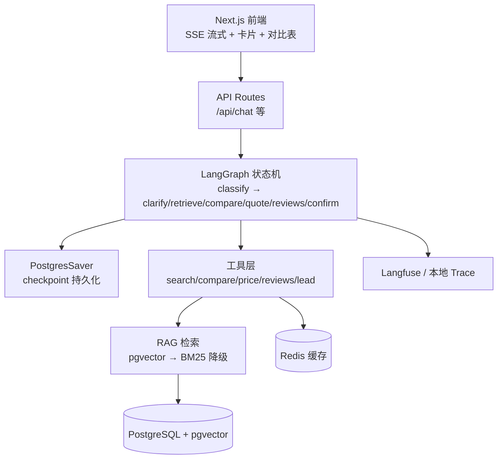

# 懂车顾问 · 选车决策 Agent

> 一个面向汽车垂类的 **Agent 全链路作品集项目**：需求澄清 → 候选筛选 → 可解释推荐 → 多车对比 → 落地价估算 → 试驾预约（人工确认）。
>
> 核心设计原则：**LLM 不做事实来源，只做理解与表达；事实交给结构化数据，决策交给规则与评测。**

---

## 1. 技术栈

| 层 | 技术 | 说明 |
| --- | --- | --- |
| 前端 | Next.js 16 + React 19 | SSE 流式渲染、车型卡片、对比表 |
| 后端 | Node + TypeScript | 与前端同语言，API Routes |
| Agent 编排 | **LangGraph 1.x** | 状态机、条件边、Checkpointer、`interrupt` |
| 数据 | PostgreSQL + **pgvector** | 结构化车型库 + 向量检索 |
| 缓存 | Redis | 工具结果缓存、可降级为内存 |
| 可观测 | **Langfuse** | trace/span，可降级为本地 trace |
| LLM | LangChain `ChatOpenAI` | 有 Key 走真实模型，无 Key 走 mock |

> **可降级设计**：没有 `DATABASE_URL` / `REDIS_URL` / `LANGFUSE_*` / `OPENAI_API_KEY` 时，项目依然可以完整跑通（内存数据 + 本地 trace + 模板回答）。

---

## 2. 快速开始

```bash
# 1. 安装依赖（Node >= 20）
pnpm install

# 2. 直接启动（mock 模式，无需任何 Key）
pnpm dev
# 打开 http://localhost:3000
```

### 接入真实 LLM

```bash
cp .env.example .env
# 填入 OPENAI_API_KEY
pnpm dev
```

### 接入 PostgreSQL + pgvector / Redis

```bash
docker compose up -d          # 启动 pgvector + redis
cp .env.example .env          # 确认 DATABASE_URL / REDIS_URL
pnpm db:seed                  # 写入车型与评测数据（有 Key 时同时生成 embedding）
pnpm dev
```

### 接入 Langfuse

在 `.env` 填 `LANGFUSE_PUBLIC_KEY` / `LANGFUSE_SECRET_KEY` / `LANGFUSE_BASE_URL`，
所有 Agent 步骤会自动上报 trace；不填则使用本地 trace（可通过 `/api/trace/:id` 查看）。

---

## 3. 运行评测

```bash
pnpm eval        # 本地 mock / CI 模式，可重复
pnpm eval:live   # 加载 .env，使用真实模型与 LLM-as-judge
# 可选：EVAL_CASE_FILTER=rec-01,rev-03,res-01 pnpm eval:live
```

当前基线：**29/29 = 100%**，覆盖：

| 类别 | 用例数 | 校验点 |
| --- | --- | --- |
| 推荐 | 9 | 候选、预算、能源、座位、多轮预算增量、上下文压缩 |
| 澄清 | 2 | 信息不足时必须追问 |
| 对比 | 2 | 生成结构化对比 |
| 报价 | 2 | 落地价计算 + 免责声明 |
| 口碑 | 3 | RAG 检索、query 改写、引用 |
| 研究 | 2 | Tool Calling 多步任务、研究+预约安全分流 |
| 预约 | 2 | interrupt 暂停 → resume → 提交成功 |
| 安全 | 4 | 注入检测、广告法替换、输入长度限制 |
| 闲聊 | 3 | 自我介绍、寒暄不应误澄清 |

评测同时输出：

- 意图准确率
- 工具选择准确率
- 执行模式准确率
- 工具参数正确率
- 多轮任务成功率
- RAG Recall@3 / MRR
- 引用支持度
- 平均 Agent 步数
- 平均上下文 Token / 触发压缩轮次
- P95 延迟
- 估算 Token / 成本
- LLM-as-judge 平均分（配置 Key 时）

任何指标低于阈值都会让 `pnpm eval` 返回非 0，GitHub Actions 会阻断合并。
阈值可通过 `EVAL_MIN_*` / `EVAL_MAX_P95_MS` / `EVAL_MAX_COST` 配置。

---

## 4. 架构



### 目录结构

```
app/
  page.tsx                 首页
  api/chat/route.ts        SSE 流式对话主接口
  api/cars/[id]/route.ts   车型详情
  api/compare/route.ts     车型对比
  api/leads/route.ts       试驾线索
  api/trace/[id]/route.ts  本地 trace 查询
components/
  Chat.tsx                 对话 UI（工具时间线、卡片、对比表、人工确认）
src/
  agent/graph.ts           ⭐ LangGraph 状态机（核心）
  agent/runner.ts          回合执行器（interrupt / resume / 护栏 / trace）
  agent/intent.ts          意图与约束解析（规则层）
  agent/llm.ts             LLM 润色 + 流式兜底
  tools/index.ts           ⭐ 工具真实实现（含鉴权与幂等校验）
  rag/retriever.ts         pgvector 检索 + 关键词降级
  db/                      pg 连接、仓储层、schema、种子脚本
  cache/redis.ts           Redis 缓存 + 内存降级
  observability/trace.ts   Langfuse + 本地 trace
  guardrails/guard.ts      ⭐ 广告法 / PII / 注入检测
  eval/eval.ts             ⭐ 29 条评测用例
```

---

## 5. 核心设计（面试重点）

### 5.1 LLM 不做事实来源

- 车型参数、价格、座位数只从结构化数据读取；
- LLM 只负责把「事实底稿」组织成自然语言；
- 因此不会出现"模型编造某车有座椅通风"的问题。

### 5.2 结构化优先，RAG 补充

- 硬约束（预算/能源/座位/车身）用 SQL/内存过滤，**精确且可解释**；
- 评测口碑走 RAG，返回带来源的引用；
- 优先 pgvector 语义检索，失败自动降级 BM25 关键词检索。

### 5.3 全局上下文解析，节点只构建自己的查询

- `resolveTurnContext()` 统一解析「这车 / 它 / 前两款 / 第二款 / 明确车型名」；
- `targetModelId` 用于口碑、报价、预约；`targetModelIds` 用于对比；
- `budgetDelta` 只表示相对预算操作（如「再加两万」为 `+2`），不直接进入工具参数；
- 预算增量在历史 constraints 合并后由 `applyBudgetDelta()` 确定性计算；
- **只有 reviews 节点**构建 RAG `retrievalQuery`，结构化推荐/对比/报价/预约不经过 query rewrite。

```text
用户输入
→ intent + constraints
→ 历史状态合并
→ targetModelId(s) / budgetDelta
→ route
→ recommend: SearchQuery
→ compare: modelIds
→ quote/book: targetModelId
→ reviews: modelId + retrievalQuery
```

口碑 query 会补全车型、指代和属性词。例如「这车高速噪音大吗」会转换为包含车型、
高速、噪音/NVH、舒适性和口碑关键词的检索 query。规则 query 始终可用；指代或
主题不足时可在 `RAG_QUERY_REWRITE_ENABLED=true` 下调用模型补全，失败自动回退。

### 5.4 多轮上下文压缩与 token budget

每次进入图前先执行 `prepare_context`：

- 原始 `messages` 继续保留，保证历史展示与审计不丢；
- 早期消息按游标增量压缩为 `contextSummary`；
- 模型和工具只读取 `contextWindowMessages`，避免每轮携带完整历史；
- 默认保留最近 8 条消息，超出后压缩旧消息；
- 旧消息超过阈值可调用模型摘要，失败回退确定性摘要；
- 预算、能源、车型、未完成事项等关键信息要求保留在摘要中。

```text
原始 messages
  ↓
summarizedCount 之前的旧消息 → contextSummary
  ↓
contextSummary + 最近消息窗口
  ↓
intent / RAG query / Tool Calling
```

配置：

```env
CONTEXT_MAX_TOKENS=3000
CONTEXT_KEEP_RECENT_MESSAGES=8
CONTEXT_SUMMARY_MAX_TOKENS=600
CONTEXT_SUMMARY_MODEL_ENABLED=true
CONTEXT_SUMMARY_MODEL_THRESHOLD=300
```

### 5.5 执行模式路由：规则优先，LLM 兜底

- 明确单步请求（筛选、报价、预约）直接走固定工作流；
- 明确多步请求（先筛选、再对比、看口碑）直接走 `tool_loop`；
- 只有规则模糊且包含“研究 / 综合 / 值得买 / 帮我看看”等语义时，才调用 LLM Router；
- LLM 只输出 `direct | tool_loop | clarify`，不直接执行工具；
- 低置信度、非法输出或超时自动回退规则路由；
- 预约、试驾、提交、支付等写操作强制 `direct + HITL`，模型不能提升为自主循环。

核心代码：

- `src/agent/executionRouter.ts`
- `EXECUTION_ROUTER_ENABLED=true`

### 5.6 受控 Tool Calling（混合编排）

不是所有请求都交给自主 Agent：

- 推荐、对比、报价、预约等确定性流程继续走固定 LangGraph 节点；
- 检测到「先筛选，再对比，然后看口碑/算价格」等多目标链路时进入 `research` 节点；
- `research` 使用 `ChatOpenAI.bindTools()`，由模型自主返回 `tool_calls`；
- 后端校验参数、执行只读工具，并把 Observation 作为 `ToolMessage` 回填模型；
- 最多循环 `TOOL_AGENT_MAX_STEPS` 次，重复调用、未知工具和工具异常都会作为 Observation 返回；
- 自主循环只暴露 `search_cars / get_car_detail / compare_cars / estimate_price / search_reviews`；
- 预约等写操作不进入自主循环，仍走原 Human-in-the-loop。

无模型或关闭 `TOOL_AGENT_ENABLED` 时，会降级为确定性的多工具计划。

### 5.7 人机协同（Human-in-the-loop）

`src/agent/graph.ts` 的 `confirmNode`：

```ts
const confirmReply = interrupt({ type: "confirm", question: "确认预约试驾吗？" });
if (!/确认|是|好/.test(String(confirmReply))) return { answer: "已取消预约。" };

const phoneReply = interrupt({ type: "phone", question: "请提供手机号" });
// 恢复后提交线索
```

- `interrupt()` 暂停图执行，问题返回前端；
- 用户回复后，`new Command({ resume })` 从 **checkpoint** 继续，不重跑已完成步骤；
- 预约提交前**服务端强制校验 `confirmed`**，不信任前端/模型。

### 5.8 护栏在代码层，不只在 prompt

- 注入检测：`detectInjection()`（HTTP 层拦截）
- 广告法：绝对化用语自动替换 + 价格免责声明
- PII：手机号脱敏展示、哈希存储
- 工具鉴权：`create_test_drive_lead` 校验 `confirmed` 与手机号格式

### 5.9 外部依赖全部可降级

| 依赖 | 缺失时 |
| --- | --- |
| OpenAI Key | 模板回答 + 打字机流式 |
| PostgreSQL | 内置样本数据 |
| Redis | 进程内 Map 缓存 |
| Langfuse | 本地 trace（可按 traceId 查询） |

---

## 6. API

| 接口 | 方法 | 说明 |
| --- | --- | --- |
| `/api/chat` | POST (SSE) | 对话主接口，支持 `message` 与 `resume` |
| `/api/cars/:id` | GET | 车型详情 |
| `/api/compare` | POST | `{ modelIds: string[] }` |
| `/api/leads` | POST | `{ sessionId, modelId, city, phone, confirmed }` |
| `/api/trace/:id` | GET | 本地 trace 详情 |
| `/api/health` | GET | LLM/DB/Redis/Langfuse 状态 |

### SSE 事件

| 事件 | 数据 | 前端用途 |
| --- | --- | --- |
| `session` | `{ sessionId }` | 绑定会话 |
| `trace` | `{ traceId }` | 排障入口 |
| `tool` | `{ name, summary, ms, ok }` | 节点结束后显示工具调用时间线 |
| `card` | `Candidate` | 车型卡片 |
| `comparison` | `Comparison` | 对比表 |
| `citation` | `Citation` | 来源引用 |
| `stage` | `{ stage, label, node? }` | 实时显示"正在筛选车型…"等进度 |
| `delta` | `{ text }` | 流式文本 |
| `interrupt` | `{ type, question }` | 人工确认/输入手机号 |
| `quickReplies` | `{ options }` | 推荐下一步 |
| `done` | `{ mode, stage }` | 结束 |

`stage` 使用 LangGraph 的 `streamMode: "tasks"` 在节点开始时发送；节点结束后的
`tool` 事件再补充命中数量、耗时和执行状态。因此前端显示的是实际执行进度，
不是图执行结束后补出来的伪进度。

---

## 7. 项目亮点（简历/面试可直接用）

1. **全链路**：Next.js 前端 → API → LangGraph 编排 → 工具 → RAG → 数据层 → 可观测。
2. **可解释推荐**：每款车给出"为什么推荐 + 短板"，且可追溯到结构化字段。
3. **真实 HITL**：`interrupt()` + Checkpointer 实现"确认 → 手机号 → 提交"的暂停恢复。
4. **工程化**：29 条评测集（100% 通过）、trace、SSE、注入/广告法护栏。
5. **可降级**：无 Key、无数据库都能跑，适合演示与面试现场。

### 面试讲法（60 秒版）

> 我做了一个汽车垂类的选车决策 Agent。核心判断是：**LLM 不能作为事实来源**。所以车型参数和价格全部走结构化数据，LLM 只负责理解需求和表达。
> 编排用 LangGraph，把"澄清→筛选→推荐→对比→报价→预约"做成状态机；预约环节用 `interrupt()` 实现人工确认，`Command(resume)` 从 checkpoint 恢复。
> 工程上配了 29 条评测集做回归，接了 trace 看每一步工具调用，并做了广告法、注入、PII 三层护栏。
> 外部依赖全部可降级：没有 Key 也能完整演示。

---

## 8. 已知限制与下一步

- [x] Checkpointer 已接入 **PostgresSaver**（无 DATABASE_URL 时自动降级 MemorySaver）
- [ ] RAG 目前是"向量 + 关键词"，可加 rerank 提升召回质量
- [ ] 车型数据为虚构演示数据，接入真实数据需做清洗与授权
- [ ] 可扩展为 MCP Server，供多个 Agent/宿主复用工具
- [ ] 可增加多 Agent 编排（选车顾问 + 价格顾问 + 内容顾问）

---

## 8.1 Checkpointer（状态持久化）

| 条件 | 使用的 Checkpointer | 说明 |
| --- | --- | --- |
| 有 `DATABASE_URL` | **PostgresSaver** | 状态写入 `checkpoint_*` 表，跨重启/多实例恢复 |
| 无 `DATABASE_URL` | MemorySaver | 仅内存，适合本地开发/测试 |
| PG 连接失败 | MemorySaver（自动降级） | 不影响主流程 |

PostgresSaver 首次运行会自动建表：

```sql
checkpoint_migrations
checkpoints
checkpoint_blobs
checkpoint_writes
```

清理 30 天未活跃会话的检查点：

```bash
psql "$DATABASE_URL" -f scripts/clear-checkpoints.sql
```

## 9. 数据与合规声明

- 本项目所有车型、参数、价格、评测均为**虚构演示数据**，不代表任何真实在售车型；
- 价格估算仅供参考，实际以经销商报价与官方配置为准；
- 不构成购买建议；不涉及任何公司内部数据。

---

## 10. 本地数据库（macOS 一键脚本）

如果本机已经装好 PostgreSQL 14 + pgvector + Redis（二进制在 `/usr/local/opt/`），直接运行：

```bash
bash scripts/local-db.sh
```

脚本会依次完成：

1. 初始化数据目录（首次运行）
2. 启动 PostgreSQL（端口 5432）
3. 创建数据库 `car_advisor`
4. 启用 `vector` 扩展
5. 启动 Redis（端口 6379）
6. 写入种子数据（12 车型 / 24 配置 / 24 评测）
7. 打印行数与扩展版本做验证

然后：

```bash
pnpm dev
```

打开 `http://localhost:3000/api/health`，应看到 `dataMode: "postgres"`、`cacheMode: "redis"`。

> ⚠️ 必须在**你自己的终端**运行（不要在 Codex 沙箱内），因为 PostgreSQL 需要 `shmget` 系统调用。

---

## 11. 本地 Trace（无需任何外部平台）

| 接口 | 说明 |
| --- | --- |
| `GET /api/trace/:id` | 单个 trace 详情（含所有 span） |
| `GET /api/traces?limit=50` | 最近的 trace 列表 |

一次对话记录的 span：

```
agent.turn
├── graph.invoke       LangGraph 执行（stage / interrupted / error）
├── node:prepare_context  上下文压缩与 token budget
├── router:execution    direct / tool_loop / clarify 路由
├── node:classify      意图、约束、目标车型
├── node:retrieve / compare / quote / reviews / research / confirm
├── tool:search_cars   工具调用（参数、结果摘要、耗时）
├── tool:compare_cars
├── tool:estimate_price
├── tool:search_reviews
├── tool:create_test_drive_lead
└── llm:polish         LLM 润色（模型、字符数、是否降级、耗时）
```

- 前端右上角「查看 Trace」可直接看时间线
- 异常路径会写入 `error` 并闭环（不会留下未结束的 span）
- Trace 顶部显示 `executionMode`、`executionRouteSource`、intent、上下文压缩和 token
- 护栏替换的告警记录在 `output.guardrailWarnings`

有 PostgreSQL 时会持久化到 `traces` 表；没有数据库时保存在进程内存（最多 200 条）。
配置 Langfuse 后，同样的 trace/span 也会上报远端。

---

## 12. 安全、测试与限流（P0/P1 加固）

### 身份与越权（Demo 级）

前端在 localStorage 生成 `userId`，所有请求带 `x-user-id` 头：

- `GET /api/session/:id`：只有会话所有者可读，否则 **403**
- `GET /api/sessions`：只返回当前用户的会话
- `POST /api/leads`：缺少身份返回 **401**
- `POST /api/chat`：按用户限流 **20 次/分钟**，超限返回 **429**

> 这是演示级身份（无密码/无 JWT）。生产应替换为登录态 + JWT/Session + 行级权限。

### 预约幂等

`leads` 表新增 `idempotency_key` 唯一索引。同一「会话 + 车型 + 手机号」重复提交只落一条：

```json
{ "ok": true, "summary": "该预约已提交过，无需重复提交（北京）", "data": { "duplicated": true } }
```

### 确认意图解析

`src/agent/confirm.ts` 采用 **否定优先 + 模棱两可重问**：

| 输入 | 结果 |
| --- | --- |
| 确认 / 好的 / 可以 / OK | confirm |
| **不好 / 不行 / 取消 / 确认取消** | cancel |
| 不确定 / 随便 / 再看看 | ambiguous（重新询问，绝不默认执行） |

### 测试

```bash
pnpm typecheck   # tsc --noEmit
pnpm test        # 86 个单元测试（node:test）
pnpm eval        # 29 条端到端评测
```

### Trace 持久化

trace 现在同时写入 Postgres `traces` 表，**重启后仍可查询**：

```bash
curl http://localhost:3000/api/trace/<traceId>
curl "http://localhost:3000/api/traces?limit=10"
```

---

## 13. 代码结构（前端已拆分）

`components/Chat.tsx` 只负责状态与 SSE，展示拆成 5 个子组件：

```
components/
├── Chat.tsx              # 主容器：状态 / SSE / 事件分发（356 行）
└── chat/
    ├── types.ts          # Message / Interrupt / Health / SessionSummary
    ├── utils.ts          # uid / userId / 时间格式化 / Markdown 渲染
    ├── Header.tsx        # 顶部状态徽章 + 历史/新对话/Trace 入口
    ├── MessageItem.tsx   # 单条消息：工具时间线 / 卡片 / 对比表 / 引用 / 确认
    ├── Composer.tsx      # 输入框与发送/停止
    ├── TraceModal.tsx    # Trace 详情弹层
    └── HistoryModal.tsx  # 历史会话弹层
```

## 14. 代码质量脚本

```bash
pnpm typecheck   # TypeScript 类型检查
pnpm lint        # ESLint（0 errors）
pnpm test        # 86 个单元测试
pnpm eval        # 29 条端到端评测
pnpm build       # 生产构建
```

> 说明：TypeScript 固定为 5.x（TypeScript 7 尚未被 `typescript-eslint` 支持）。

---

## 15. 规则 + 模型混合的意图解析

规则正则覆盖不全（例如「带娃推荐什么车」里的「带娃」不在词表里），所以在规则层之上加了一层**模型补充**。

### 执行流程

```
用户输入
  ↓
① 规则层（intent.ts 的 parseMessage）—— 快、免费、可控
  ↓
② needsModelFallback() 判断是否需要补充
   - intent = unknown
   - 或意图是弱匹配（例如命中 compare，但没点名车型、没有候选、没有序数引用）
   - 或 recommend / compare / price / reviews 但没解析到任何上下文标签
  ↓ 需要
③ 模型层（intentModel.ts）—— 只做结构化抽取，输出 JSON
  ↓
④ 校验层 —— intent 白名单、energy/bodyType/usage 枚举、预算范围、置信度 ≥ 0.6
  ↓
⑤ 合并层（mergeIntent.ts）—— 规则优先，模型只补缺
  ↓
⑥ 输出 intent + constraints（并记录 intentSource = rule / hybrid）
```

### 合并原则

| 字段 | 规则 |
| --- | --- |
| `intent` | 规则明确时优先；规则 unknown 或弱匹配时采用模型判断 |
| `constraints` | 同名常量/数组字段以规则为准，模型只补规则没解析出的字段 |
| 冲突 | 强匹配以规则为准，同时打印冲突日志；弱匹配允许模型覆盖 |

### 为什么需要 `weakIntent`

最初 compare 的正则包含裸关键词「比较」，导致：

```text
"我要去比较远的地方，推荐什么车"
→ 规则命中「比较」
→ intent 被误判为 compare
→ 且不会触发模型复核
→ 走对比流程，要求澄清车型
```

修复分三层：

1. 收紧 compare 正则，去掉裸「比较」，只保留「比较一下 / 比较这两款 / 对比 / 差异」等明确表达。
2. 新增 `weakIntent`：compare 没点名车型、没有候选、没有序数引用时视为证据不足。
3. `needsModelFallback()` 对弱意图触发模型复核，`mergeIntent()` 允许模型覆盖弱意图。

另外在模型抽取提示词中明确：`"去比较远的地方"` 表示 `usage = ["长途"]`，不是对比车型。

### 降级策略

| 情况 | 行为 |
| --- | --- |
| 未配置 `OPENAI_API_KEY` | 完全跳过模型，只用规则 |
| `INTENT_MODEL_ENABLED=false` | 强制关闭模型补充 |
| 模型超时（默认 4s） | 返回 null，用规则结果 |
| 输出非 JSON / 校验不过 / 置信度低 | 返回 null，用规则结果 |

### 可观测

- `trace.end()` 的 output 里记录 `intentSource: "rule" | "hybrid"`
- 规则与模型冲突时打印 `[intent] 规则与模型冲突（已按规则优先）: ...`

### 实测效果

```text
用户："带娃推荐什么车"

规则层： intent=recommend, constraints={}          ← 没识别到「带娃」
是否需要补充： true
模型层： { intent:"recommend", constraints:{ usage:["家用","空间"] }, confidence:0.62 }
合并结果： usage = ["家用","空间"], adopted = true
```
